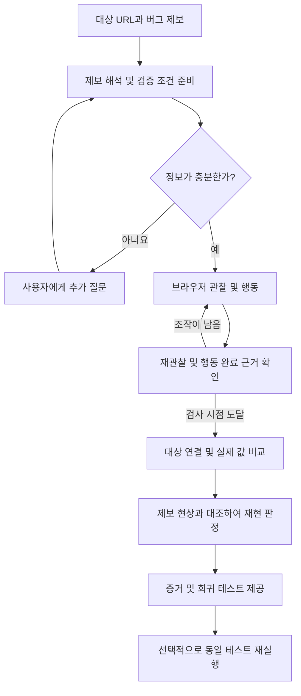
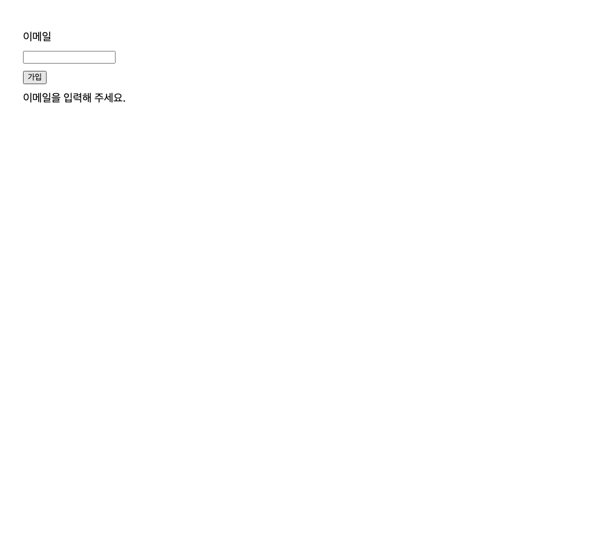

# G129 이현준 — Repro 개발 보고서

> 버그 제보를 브라우저에서 재현하고, 증거와 회귀 테스트를 제공하는 QA 보조 Agent

- 제출 번호: **G129**
- 성명: **이현준**
- 작성일: 2026-10-22
- 제출 저장소: [test-lee04/Repro](https://github.com/test-lee04/Repro)

## 1. 진행 사항 소개

### 주제와 해결하려는 문제

개발자와 QA는 버그 제보를 받으면 부족한 정보를 확인하고, 재현 절차를 실행하고, 증거를 수집한 뒤 회귀 테스트를 별도로 작성해야 한다. ReproPilot은 자연어 제보와 대상 URL을 받아 이 과정을 연결한다. 주요 사용자는 제보의 실제 재현 여부와 실행 근거를 확인하려는 개발자와 QA다.

특정 쿠폰이나 검색 기능에만 분기하는 구조가 아니라, 제보에 따라 행동과 검증 조건을 구성하는 것을 목표로 했다. 장바구니, 문서 저장, 검색, 가입 검증은 개발과 평가에 사용하는 사례다. 다만 현재 지원 도구와 평가 범위에는 한계가 있어 모든 웹사이트와 모든 버그를 처리한다고 주장하지 않는다. 소스코드 자동 수정은 구현 범위에 포함하지 않는다.

### 주요 Task 및 구현 결과

| Task | 구현한 기능 |
| --- | --- |
| 제보 해석 | 초기 조건, 행동 순서, 입력값, 실제 현상, 정상 기대 동작 구조화 |
| 추가 확인 | 정보가 부족하거나 기대 문구가 모호할 때 질문하고 실제 답변을 근거로 반영 |
| 브라우저 실행 | 관찰한 요소에 입력·클릭·새로고침을 수행하고 화면을 다시 관찰 |
| 조건 검증 | 검사 시점 확인, 대상 연결, 실제 입력값·표시 문구 읽기 및 비교 |
| 재현 판정 | 정상 기대 조건의 충족 여부와 제보한 실제 현상의 일치를 구분해 판정 |
| 테스트 생성 | 실제 행동 기록과 검증 조건으로 회귀 테스트 파일 생성 |
| 테스트 재실행 | 동일한 테스트의 원래 환경 실패와 수정 환경 통과를 연결해 검증 |
| 사용자 화면·API | 제보 접수, 추가 답변, 상태·결과 조회, 파일 다운로드, 재실행 관리 |
| 평가 | 정답이 분리된 로컬 사례로 반복 실행하고 판정·시간·모델 사용량 기록 |

### 전체 실행 흐름



개발자가 별도로 수정한 환경이 있으면 생성한 테스트를 다시 실행한다. 정상 환경은 미리 준비한 비교 대상이며 Agent가 버그 사이트를 자동 수정해서 만드는 결과물이 아니다.

## 2. 사용한 기술 요소와 구현 내용

| 기술 요소 | 적용 내용 |
| --- | --- |
| Python·비동기 실행 | 모델 호출과 브라우저 실행을 연결하고 제한 시간 및 취소 처리 |
| Ollama·qwen3:8b | 자연어 해석, 행동 선택, 검사 대상 연결과 의미 검토 |
| Pydantic·JSON Schema | 모델 응답의 필드, 상태별 제약, 근거와 참조 관계 검증 |
| Playwright·Chromium | 브라우저 관찰·조작, 스크린샷 수집, 생성 테스트 재실행 |
| FastAPI·Uvicorn | 작업 접수, 상태 조회, 추가 답변, 결과·파일 제공 API |
| HTML·CSS·JavaScript | 제보 입력과 결과 확인을 위한 대시보드 |
| 의존성 주입 | 모델과 작업 서비스를 주입해 실제 구현과 검사 대역을 분리 |
| 모듈화 | 해석·행동·조건 생성·대상 연결·비교·판정·테스트 생성 역할 분리 |
| 단위·통합·화면 검사 | 잘못된 응답·오래된 관찰·실행 오류 및 화면 흐름 검증 |
| 실행 계측 | 실제 모델 호출 수, 토큰 사용량, 소요 시간과 결과 파일 기록 |

역할별 모델 처리 모듈과 브라우저 도구를 연결한 Agent 흐름이다. 독립 Agent 간 병렬 협업을 구현한 Multi-Agent 시스템으로 표현하지 않는다. MCP, RAG, LangSmith는 현재 핵심 실행 경로에 적용하지 않았다.

### 구현 과정에서 개선한 부분

1. **서비스에 종속된 판정 분리:** 쿠폰 기준 판정은 평가용 참조 규칙으로 분리하고, 일반 제보에는 공통 행동·조건 형식을 사용하도록 구성했다.
2. **실제 관찰 기반 행동:** 현재 관찰에 없는 대상, 비활성화 대상, 허용되지 않은 행동을 거부한다. 과거 관찰의 식별자를 현재 대상으로 재사용하지 않는다.
3. **기대 동작의 근거 검증:** 원래 제보, 요구사항, 실제 사용자 답변을 구분한다. 모델이 만든 질문이나 원문에 없는 문장을 사용자 근거로 쓰지 못하게 했다.
4. **행동 종료와 재현 성공 분리:** 행동을 마쳤다는 모델 응답만으로 성공 처리하지 않는다. 실제 실행 기록으로 순서와 검사 시점을 확인하고, 정상 기대와 실제 결과를 비교한다.
5. **잘못된 재입력 방지:** 저장과 새로고침을 끝낸 뒤 값이 비어 있더라도 정상 결과를 만들기 위해 같은 행동을 반복하지 않도록 완료 근거를 확인한다.
6. **확인 답변 반영 시 해석 보존:** 기대 문구만 확인한 경우 기존 초기 조건과 행동 순서를 유지한다. 사용자가 행동도 정정하면 전체 재해석 경로를 이용한다.
7. **모호한 비교 조건 처리:** 정확한 문구나 포함·전체 일치 의미를 확정하지 못하면 임의로 승인하지 않고 필요한 질문을 한다.
8. **오류와 버그 구분:** 접속 실패, 읽기 오류, 모호한 대상, 오래된 관찰을 버그 재현으로 처리하지 않는다.
9. **테스트 생성과 수정 검증 구분:** 파일 생성만으로 검증 완료를 표시하지 않는다. 같은 테스트의 원래 환경 조건 실패와 수정 환경 통과가 확인돼야 수정 검증 완료로 기록한다.

### 화면 캡처 및 실행 증거

아래 그림은 실제 평가 실행에서 저장한 대상 브라우저 화면이다. 대시보드 화면이나 임의로 재구성한 예시가 아니다.

**그림 1. 빈 이메일로 가입을 시도한 버그 환경의 실제 화면**


정상 기대 문구는 `이메일을 입력해 주세요.`이지만 실제 관찰 문구는 `가입 완료`였다. 기대 조건 불충족과 제보 현상 일치가 확인됐다.

**그림 2. 같은 조건의 정상 환경 실제 화면**



정상 환경에서는 기대 문구를 확인해 미재현으로 판정했다. 저장된 평가 기록은 [확인 답변 반영 평가 결과](docs/evaluation/confirmed-summary.md)에서 확인할 수 있다.

**제출 전 추가할 최종 대시보드 캡처**

현재 보고서에는 위 대상 브라우저의 실제 실행 화면이 포함돼 있다. 사용자 화면 전체를 보여주는 아래 캡처는 별도로 저장해야 한다. 파일을 넣은 뒤 이 안내 문장을 삭제하고 이미지를 연결한다.

- `docs/images/dashboard-result.png`: 제보 입력, 재현 판정, 기대값·실제값이 함께 보이는 화면
- `docs/images/dashboard-replay.png`: 동일 테스트 재실행 및 수정 검증 결과 화면

이 두 화면은 실제 서비스 시연 화면을 제출하기 위한 미완료 항목이다. 저장되지 않은 화면을 완료한 것처럼 표시하지 않았다.

## 3. 평가 결과

### 평가 방법

문서 제목 저장, 검색 결과, 빈 이메일 가입 검증, 정보가 부족한 제보를 로컬 평가 자료로 구성했다. 버그·정상 환경 이름과 정답을 Agent 입력에 주지 않고, 제보와 대상 URL을 전달했다. 실패와 보류도 분모에 포함했다. 단위 검사에서 모델 대역을 사용한 결과와 실제 Ollama 실행 결과를 구분했다.

아래 수치는 실제 `qwen3:8b` 실행 기록이다. 자료 버전은 `r8-1-v1`이며 각 보고서에 자료 및 앱 코드 식별값이 저장돼 있다.

| 지표 | 추가 답변 없는 반복 평가 | 확인 답변 반영 후 반복 평가 |
| --- | --- | --- |
| 평가 범위 | 4종 제보, 총 14회 | 가입 검증 제보, 총 4회 |
| 판정 일치 | **10/14 (71.43%)** | **4/4 (100%)** |
| 버그 환경 탐지 | 4/6 | 2/2 |
| 정상 환경 미재현 확인 | 4/6 | 2/2 |
| 정보 부족 제보의 질문 요청 | 2/2 | 해당 없음 |
| 회귀 테스트 생성 | 8/12 | 4/4 |
| 시도한 동일 테스트 수정 검증 | 4/4 | 2/2 |
| 평균 실행 시간 | 72.25초 | 55.02초 |
| 모델 호출 | 102회 | 28회 |
| 모델 호출 오류 | 0회 | 0회 |

출처: [추가 답변 없는 평가 원본 요약](docs/evaluation/automatic-summary.md), [확인 답변 반영 평가 원본 요약](docs/evaluation/confirmed-summary.md).

추가 답변 없는 평가에서는 문서 저장과 검색이 모두 정답과 일치했다. 가입 검증은 문구와 비교 의미를 확정하지 못해 4회 모두 추가 정보 요청으로 종료됐다. 정상 환경 오탐은 0/6이지만 이 중 2회는 판정이 끝나지 않았으므로 정상 환경 전체를 정확히 판정했다고 해석할 수 없다.

확인 답변 반영 평가는 사용자가 `"이메일을 입력해 주세요."라는 문구가 포함되면 된다`고 명시한 뒤 실행했다. 이전 질문 생성 및 사용자 답변 시간은 제외하고, 이후 실행만 측정했다. 선택한 회귀 테스트 재실행 시간도 평균 실행 시간과 별도로 기록한다.

두 열은 평가 사례 구성과 사람의 개입 여부가 다르므로, 이를 자동 성능의 개선 전·후 비교나 시간 단축률로 해석하지 않는다. 수동 방식 또는 다른 Agent와의 통제된 비교, 금전 비용 및 전체 재시도 횟수의 비교는 수행하지 않았다. 선택 항목인 개선 전·후 비교 결과로 주장하지 않는다.

### 검증한 오류 처리

- 관찰되지 않은 대상과 모호한 대상의 선택 거부
- 입력값과 표시 문구의 읽기 종류 혼동 거부
- 오래된 관찰 및 서로 다른 조건의 기록 혼합 거부
- 근거 없는 기대값과 사용자 답변 출처 위조 거부
- 미완료 행동·검사 시점을 완료로 처리하는 응답 거부
- 중복 접수, 재실행 오류, 취소와 서버 재시작 후 이력 조회
- 기대 문구 확인 시 행동 보존과 전체 정정 경로 구분

## 4. 느낀 점 및 향후 개선 사항

### 느낀 점

모델이 JSON 형식을 맞춰 반환하는 것과 의미가 올바른 것은 별개라는 점을 확인했다. 원문 인용이 존재해도 검사 대상 범위를 잘못 잡거나, 정상 기대 문구를 잘못 추출하거나, 이미 수행한 행동을 반복할 수 있었다. 따라서 프롬프트뿐 아니라 형식 검사, 출처 확인, 실제 브라우저 관찰, 행동 기록의 참조 검증이 함께 필요했다.

또한 결과를 무조건 성공으로 만드는 것보다 미재현, 정보 부족, 실행 오류와 판정 보류를 구분하는 것이 개발자에게 더 유용했다. 테스트 파일 생성과 실제 재실행 검증을 분리하면서 결과를 설명할 수 있는 근거의 중요성도 배웠다.

### 현재 한계와 개선 방향

- 현재 핵심 행동은 입력·클릭·새로고침이고 실제 검증은 표시 문구와 입력값 중심이다. 로그인, 파일 업로드, 복잡한 화면 전환과 다양한 검증 종류를 확장할 필요가 있다.
- 보고된 초기 조건은 실제 충족을 보장하지 않는다. 초기 상태 확인과 필요한 준비 행동의 근거 검증을 강화할 필요가 있다.
- 모호한 문구는 추가 질문이 필요하며, 현재 로컬 모델의 의미 검토가 과도한 질문이나 반복 검토를 만들 수 있다. 모델별 비교 및 실제 사용자 제보 평가를 추가하고 싶다.
- 반복 모델 호출로 사례당 수십 초에서 약 2분이 걸렸다. 정확도와 근거를 유지하면서 불필요한 검토 호출을 줄이고 싶다.
- 현재 성능은 소수의 준비된 로컬 사례에 한정된다. 처음 보는 사이트와 제보를 별도로 평가하고 수동 작업 및 기준 방식과 비교해야 한다.
- 공개 배포 전에는 접근 권한, 실행 대상 관리, 민감 정보 보호와 자원 제한을 보강해야 한다.

## 5. 실행 방법 및 사이트 시연

### 설치

Python 3.11과 Ollama가 설치된 환경에서 실행한다.

```sh
git clone https://github.com/test-lee04/Repro.git
cd Repro
python3 -m venv venv
source venv/bin/activate
python -m pip install -r requirements.txt
python -m playwright install chromium
cp .env.example .env
ollama pull qwen3:8b
```

Ollama 서버가 실행 중이어야 하며 `.env`의 `LLM_BACKEND`, `OLLAMA_BASE_URL`, `OLLAMA_MODEL`을 확인한다. 현재 구현은 Ollama 연결을 지원한다.

### 사용자 화면 실행

```sh
python -m uvicorn app.main:app --host 127.0.0.1 --port 8000
```

브라우저에서 `http://127.0.0.1:8000`에 접속한다. API 문서는 `/docs`에서 확인한다. 접속 가능한 대상 사이트의 URL과 제보를 입력한다.

### 검사 및 평가 명령

```sh
python -m scripts.check_execution_contract
python -m scripts.check_retained_interpretation
python -m scripts.check_expectation_clarification
python -m scripts.check_confirmed_evaluation
python -m scripts.check_replay_api
python -m scripts.check_replay_dashboard
python -m eval.run_eval --case all --repeats 2 --verify-tests
```

앞의 검사는 계약·통합·화면 동작을 확인하며, 마지막 명령은 실제 모델을 사용하는 평가다. 확인 답변 반영 평가에는 해당 제보의 실제 답변이 저장된 `--confirmed-plan` 경로가 필요하다. `artifacts`는 Git에 포함되지 않으므로 과거 실행 폴더는 새로 복제한 저장소에 자동으로 생기지 않는다.

## 6. 주요 파일 구조

```text
app/
  main.py                         서버와 대시보드 연결
  agent/
    report_schema.py              제보 및 초기 조건 형식
    report_parser.py              제보 해석과 근거 검증
    action_planner.py             관찰 기반 행동 선택
    checkpoint_reviewer.py        행동 완료와 검사 시점 검토
    verification_planner.py       검증 조건 생성과 확인 질문
    target_binder.py              관찰한 검사 대상 연결
    reproduction_loop.py          행동 실행 반복
    reproduction_workflow.py      전체 실행 흐름
    reproduction_assessor.py      제보 현상과 실행 결과 대조
  browser/                        브라우저 세션·관찰·조작·값 읽기
  testing/                        조건 비교·테스트 생성·재실행·판정
  api/                            작업·추가 답변·재실행 관리 API
  static/                         사용자 대시보드
scripts/                          기능별 계약·통합·화면 검사
eval/                             평가 사례·계측·실행·결과 집계
docs/                             제출용 화면 및 평가 요약
artifacts/                        실행별 증거와 산출물, Git 제외
```